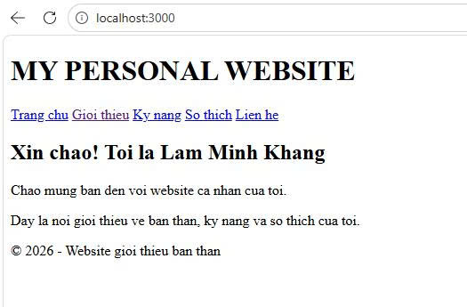
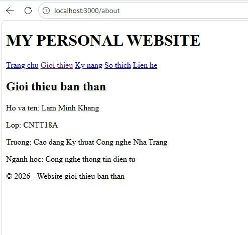
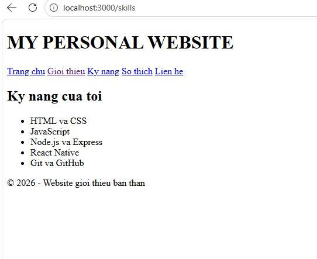
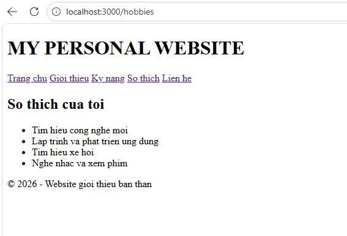
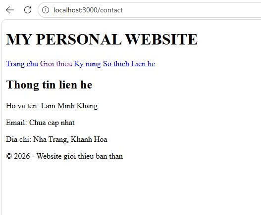
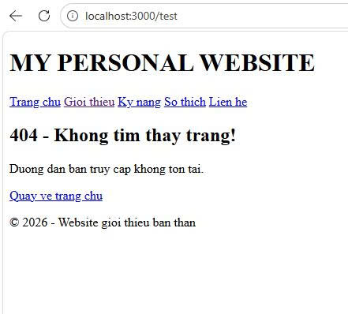
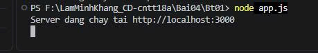

# BAI 04 - BT01: WEBSITE GIỚI THIỆU BẢN THÂN

## 1. Thông tin sinh viên

- **Họ và tên:** Lâm Minh Khang
- **Lớp:** CNTT18A
- **Trường:** Cao đẳng Kỹ thuật Công nghệ Nha Trang
- **Ngành học:** Công nghệ thông tin điện tử

## 2. Giới thiệu bài tập

Xây dựng website giới thiệu bản thân bằng Node.js và Express.

Website có giao diện HTML/CSS đơn giản, menu điều hướng và các trang thông tin cá nhân.

## 3. Các chức năng

| Đường dẫn | Chức năng |
|---|---|
| `/` | Trang chủ |
| `/about` | Giới thiệu bản thân |
| `/skills` | Kỹ năng |
| `/hobbies` | Sở thích |
| `/contact` | Thông tin liên hệ |
| Đường dẫn không tồn tại | Hiển thị lỗi 404 |

## 4. Công nghệ sử dụng

- Node.js
- Express.js
- HTML
- CSS
- Git và GitHub

## 5. Các bước thực hiện

### Bước 1: Khởi tạo dự án

```bash
npm init -y
```

### Bước 2: Cài đặt Express

```bash
npm install express
```

### Bước 3: Chạy chương trình

```bash
node app.js
```

Hoặc:

```bash
npm start
```

### Bước 4: Truy cập website

```text
http://localhost:3000
```

## 6. Hình ảnh kết quả

### Trang chủ


### Trang giới thiệu


### Trang kỹ năng


### Trang sở thích


### Trang liên hệ


### Trang lỗi 404


### Kết quả chạy trên Terminal


## 7. Khảo sát dịch vụ hosting miễn phí

| Dịch vụ | Đặc điểm |
|---|---|
| Render | Hỗ trợ triển khai ứng dụng Node.js bằng Web Service |
| Vercel | Hỗ trợ Node.js thông qua Functions |
| Netlify | Hỗ trợ Node.js thông qua Functions |

**Dịch vụ lựa chọn:** Render vì có thể triển khai ứng dụng Express trực tiếp dưới dạng Web Service.

## 8. Triển khai website lên Render

1. Đưa mã nguồn dự án lên GitHub.
2. Truy cập https://render.com/.
3. Đăng nhập bằng tài khoản GitHub.
4. Chọn New → Web Service.
5. Kết nối repository chứa bài tập.
6. Cấu hình:
   - Root Directory: `Bai04/Bt01`
   - Build Command: `npm install`
   - Start Command: `npm start`
   - Instance Type: Free
7. Chọn Deploy Web Service.
8. Chờ Render triển khai thành công và truy cập đường dẫn website.

**Đường dẫn website sau khi triển khai:**  
Chưa triển khai.

## 9. Kết luận

Qua bài thực hành, em đã biết cách khởi tạo dự án Node.js, cài đặt Express, xây dựng các route, thiết kế giao diện HTML/CSS, xử lý lỗi 404 và tìm hiểu cách triển khai website lên dịch vụ hosting.
