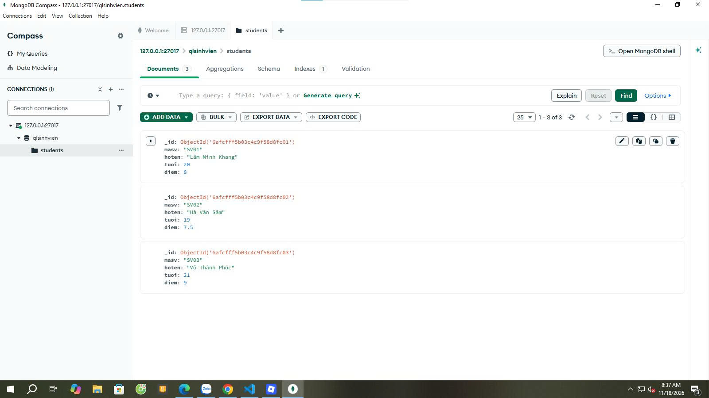
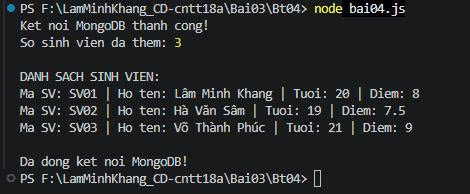

# Bai03 - Bt04: MongoDB với Node.js

## 1. Mục tiêu
- Kết nối MongoDB bằng Node.js.
- Tạo Database `qlsinhvien`.
- Tạo Collection `students`.
- Thêm dữ liệu sinh viên bằng `insertMany()`.
- Hiển thị danh sách sinh viên bằng `find()`.
- Đóng kết nối MongoDB.

## 2. Công nghệ sử dụng
- Node.js
- MongoDB
- MongoDB Compass
- Visual Studio Code

## 3. Cấu trúc thư mục

```text
Bt04/
├── bai04.js
├── Readme.md
└── visual/
    ├── mongodb.jpg
    └── ketqua.jpg
```

## 4. Cách chạy chương trình

Mở Terminal tại thư mục Bt04 và chạy:

```bash
node bai04.js
```

## 5. Kết quả

### MongoDB Compass



### Kết quả chạy chương trình


