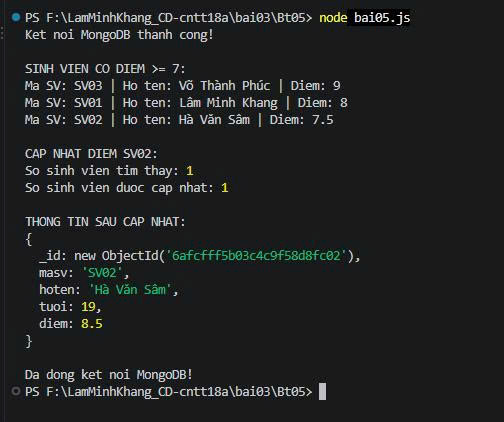
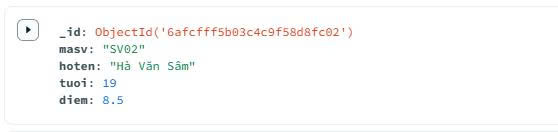

# Bai03 - Bt05: Tim kiem, sap xep va cap nhat MongoDB

## 1. Muc tieu
- Tim sinh vien co diem >= 7 bang find() va $gte.
- Sap xep diem giam dan bang sort().
- Cap nhat diem sinh vien theo masv bang updateOne() va $set.
- Hien thi thong tin sau khi cap nhat.

## 2. Cong nghe
- Node.js
- MongoDB
- MongoDB Compass
- Visual Studio Code

## 3. Database
- Database: qlsinhvien
- Collection: students

## 4. Cach chay
Mo Terminal tai thu muc Bt05 va chay:

```bash
node bai05.js
```

## 5. Ket qua

### Tim kiem va sap xep sinh vien



### Cap nhat MongoDB



