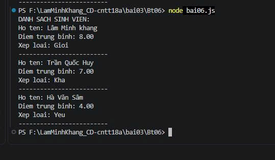

# Bai03 - Bt06: Module tinh diem va xep loai sinh vien

## 1. Muc tieu
- Tinh diem trung binh 3 mon.
- Xep loai hoc tap.
- Su dung module.exports de xuat ham.
- Su dung require() de goi ham tu file khac.

## 2. Quy tac xep loai
- Gioi: diem trung binh >= 8.
- Kha: diem trung binh >= 6.5.
- Trung binh: diem trung binh >= 5.
- Yeu: diem trung binh < 5.

## 3. Cau truc thu muc

```text
Bt06/
├── bai06.js
├── xulyDiem.js
├── Readme.md
└── visual/
    └── ketqua.jpg
```

## 4. Cach chay

```bash
node bai06.js
```

## 5. Ket qua


