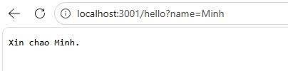
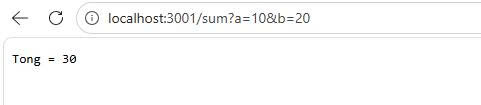
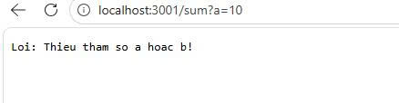

# Bai03 - Bt07: Web Server HTTP va URL

## 1. Muc tieu
- Su dung module `http` de tao Web Server.
- Su dung doi tuong `URL` de xu ly URL va tham so.
- Tao Web Server tai cong 3001.
- Xu ly duong dan `/hello` va `/sum`.
- Kiem tra tham so va hien thi thong bao loi.

## 2. Chuc nang

### Duong dan /hello
Truy cap:
```text
http://localhost:3001/hello?name=Minh
```

Ket qua:
```text
Xin chào Minh.
```

### Duong dan /sum
Truy cap:
```text
http://localhost:3001/sum?a=10&b=20
```

Ket qua:
```text
Tổng = 30
```

### Xu ly loi
- Thieu tham so name.
- Thieu tham so a hoac b.
- Gia tri a, b khong phai so.
- Duong dan khong ton tai.

## 3. Cau truc thu muc

```text
Bt07/
├── bai07.js
├── Readme.md
└── visual/
    ├── hello.jpg
    ├── sum.jpg
    ├── error.jpg
    └── server.jpg
```

## 4. Cach chay

Mo Terminal tai thu muc Bt07 va chay:

```bash
node bai07.js
```

Web Server chay tai:

```text
http://localhost:3001
```

## 5. Ket qua

### Chuc nang Hello


### Chuc nang tinh tong


### Kiem tra loi


### Web Server
