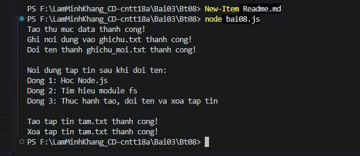

# BAI03 - BT08: THUC HANH MODULE FS

## 1. Gioi thieu

Bai tap su dung module `fs` trong Node.js de thuc hien cac thao tac voi thu muc va tap tin.

## 2. Noi dung thuc hien

- Tao thu muc `data`.
- Tao tap tin `ghichu.txt`.
- Ghi it nhat 3 dong noi dung vao tap tin.
- Doi ten `ghichu.txt` thanh `ghichu_moi.txt` bang `fs.rename()`.
- Doc va hien thi noi dung tap tin sau khi doi ten.
- Tao tap tin `tam.txt`.
- Xoa tap tin `tam.txt` bang `fs.unlink()`.

## 3. Lenh chay chuong trinh

```bash
node bai08.js
```

## 4. Ket qua

Chuong trinh thuc hien thanh cong cac thao tac tao thu muc, ghi file, doi ten, doc file va xoa file.

## 5. Hinh anh minh chung


### Anh 2: Ket qua chay chuong trinh


