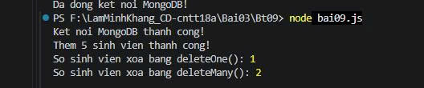
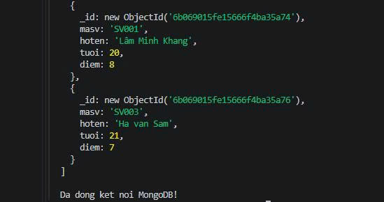
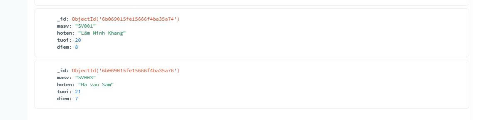

# BAI03 - BT09: THUC HANH MONGODB DELETE

## 1. Gioi thieu

Bai tap su dung MongoDB va Node.js de thuc hanh cac thao tac xoa du lieu trong collection.

- Database: `qlsinhvien`
- Collection: `students_test`

## 2. Noi dung thuc hien

- Ket noi database `qlsinhvien`.
- Them 5 sinh vien mau gom: `masv`, `hoten`, `tuoi`, `diem`.
- Su dung `deleteOne()` xoa sinh vien theo ma `SV005`.
- Su dung `deleteMany()` xoa cac sinh vien co diem duoi 5.
- Hien thi so ban ghi da xoa.
- Su dung `find()` hien thi danh sach sinh vien con lai.

## 3. Lenh chay chuong trinh

```bash
node bai09.js
```

## 4. Ket qua du kien

- Them thanh cong 5 sinh vien.
- `deleteOne()` xoa 1 sinh vien.
- `deleteMany()` xoa 2 sinh vien co diem duoi 5.
- Danh sach con lai gom SV001 va SV003.

## 5. Hinh anh minh chung

### Anh 1: Ma nguon bai09.js



### Anh 2: Ket qua chay chuong trinh



### Anh 3: Du lieu trong MongoDB Compass

