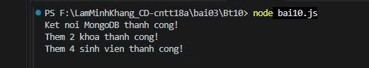
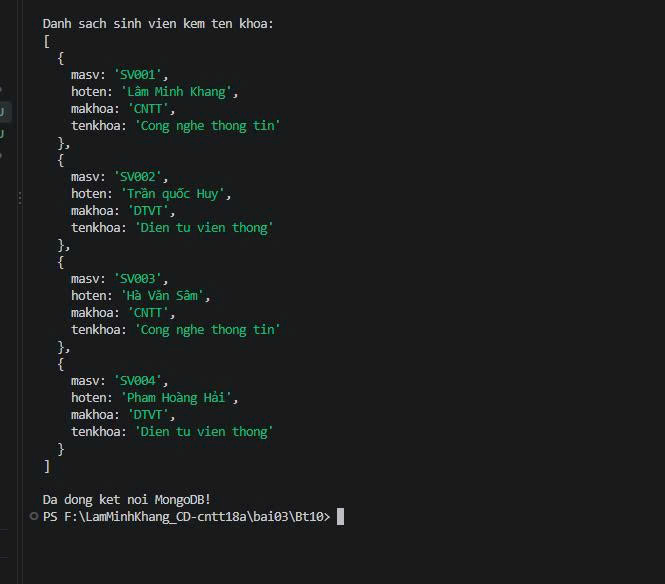
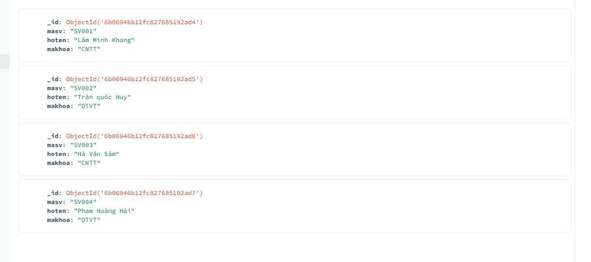

# BAI03 - BT10: THUC HANH MONGODB AGGREGATE VA LOOKUP

## 1. Gioi thieu

Bai tap su dung MongoDB va Node.js de lien ket du lieu giua sinh vien va khoa.

- Database: `qlsinhvien`
- Collection: `departments`
- Collection: `students_join`

## 2. Noi dung thuc hien

- Tao collection `departments` gom 2 khoa.
- Tao collection `students_join` gom 4 sinh vien.
- Su dung `aggregate()` ket hop `$lookup` de lien ket sinh vien voi khoa thong qua `makhoa`.
- Su dung `$unwind` va `$project` de hien thi thong tin.
- Hien thi ma sinh vien, ho ten, ma khoa va ten khoa.

## 3. Lenh chay chuong trinh

```bash
node bai10.js
```

## 4. Ket qua du kien

Chuong trinh hien thi 4 sinh vien kem ten khoa tuong ung:

- SV001 - Lâm Minh Khang - Cong nghe thong tin
- SV002 - Tran Quoc Huy - Dien tu vien thong
- SV003 - ha Van Sam - Cong nghe thong tin
- SV004 - Pham Hoang Hai - Dien tu vien thong

## 5. Hinh anh minh chung

### Anh 1: Ma nguon bai10.js



### Anh 2: Ket qua chay chuong trinh



### Anh 3: Du lieu trong MongoDB Compass

